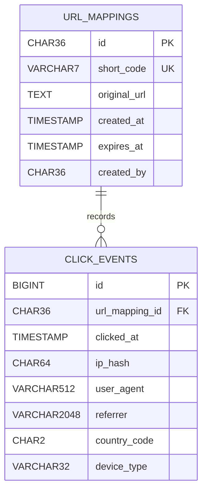

# URL Shortener Database ERD

## Current Member-1 Database Scope

## Relationship

One URL mapping can have zero or many click events.

`click_events.url_mapping_id` references `url_mappings.id`.

The foreign key uses `ON DELETE CASCADE`, so associated click events are removed when their URL mapping is deleted.

## Key Integrity Rule

`url_mappings.short_code` has a database-level UNIQUE constraint.

The short-code column uses ASCII binary collation so Base62-style values are case-sensitive.

For example:

- `Ab3xK91`
- `ab3xk91`

are treated as different short codes.
