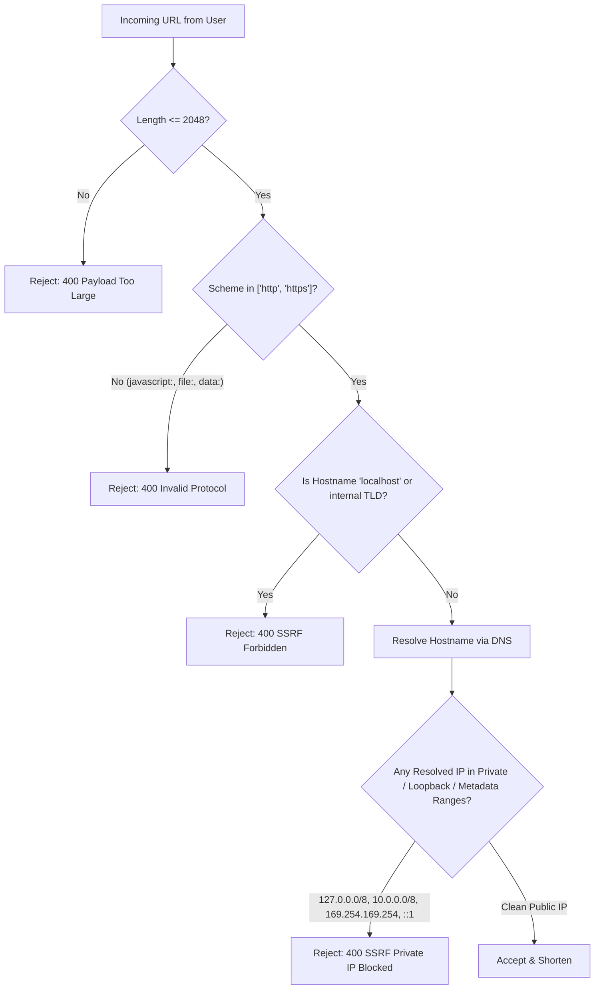

# 🛡️ Threat Model — URL Shortener System

**Author**: Member 4 — Security Engineer (Anuj)  
**Project**: URL Shortener Platform  
**Classification**: Engineering & Security Architecture Deliverable (Phase 1)  
**Scope**: Frontend (React), Backend (FastAPI), Database (MySQL/SQLAlchemy), Analytics, Network & Cache

---

## 1. Executive Summary & Security Objectives

The URL Shortener service converts arbitrary external URLs into compact, short codes and provides analytics on visitor click events. Because this system ingests untrusted user input, handles redirects, manages user accounts, and stores access analytics, it is a high-value target for:
1. **Malicious abuse & phishing** (concealing malicious landing pages).
2. **Server-Side Request Forgery (SSRF)** (probing internal cloud infrastructure).
3. **Account compromise & credential abuse** (credential stuffing, JWT forgery).
4. **Data privacy violations** (unauthorized access to analytics, raw IP tracking).
5. **Denial of Service (DoS)** (exhausting key spaces or saturating bandwidth).

---

## 2. Attack Surface Analysis

| Surface / Entrypoint | Protocol / Format | Threat Actors | Primary Risks |
| :--- | :--- | :--- | :--- |
| **`POST /api/v1/shorten`** | JSON over HTTPS | Anonymous & Registered users, Bots | SSRF, Malicious protocol injection (`javascript:`), Open redirect loops, Key exhaustion, Storage DoS |
| **`GET /{code}`** | HTTP/HTTPS GET | Public Internet Visitors, Scrapers, Crawlers | Open redirects to malware, Denial of Service, Click-fraud, Cache poisoning |
| **`POST /api/v1/auth/register` & `/login`** | JSON over HTTPS | Attackers, Credential stuffers | Brute force, Password cracking, Account enumeration, Weak credential acceptance |
| **`GET /api/v1/stats/{code}`** | JSON over HTTPS Bearer Auth | Authenticated Users, Competitors | Insecure Direct Object References (IDOR), Privacy leakage, Scraping competitors' click volumes |
| **`DELETE /api/v1/urls/{id}`** | REST over HTTPS Bearer Auth | Authenticated Users | IDOR / Unauthorized deletion of other users' active links |
| **`click_events` Logging Engine** | Server Internal Pipeline | Compromised DB / Insider threat | Storing unhashed PII (violating GDPR Article 5(1)(c) and ePrivacy) |

---

## 3. STRIDE Threat Matrix & Countermeasures

### 3.1 Spoofing Identity
- **Threat**: Attackers forge JWT access tokens or impersonate legitimate link creators.
- **Countermeasures**:
  - Cryptographically signed tokens using `HS256` with high-entropy 256-bit `JWT_SECRET_KEY`.
  - Enforce standard token claims: `sub` (user UUID), `iat` (issued at), `exp` (mandatory expiration), `type: access`.
  - Reject unsigned or `none` algorithm tokens.

### 3.2 Tampering with Data
- **Threat**: Modifying target URLs in transit, manipulating short code aliases, or altering analytics click counts.
- **Countermeasures**:
  - Strict HTTPS enforcement with HSTS (`Strict-Transport-Security: max-age=31536000`).
  - Parameterized SQLAlchemy queries prevent SQL injection tampering.
  - Whitelist-only custom alias validation (`^[a-zA-Z0-9_-]{3,30}$`) and collision checks.

### 3.3 Repudiation
- **Threat**: Users denying link creation or abuse reports lacking forensic traceability.
- **Countermeasures**:
  - `url_mappings` table explicitly stores `created_by` (linking to `users.id`) and timestamp `created_at`.
  - Structured audit logs for all administrative and authentication events.

### 3.4 Information Disclosure
- **Threat**: Direct access to another user's URL metrics (IDOR), leaking visitor IP addresses, or exposing internal stack traces.
- **Countermeasures**:
  - **Object-Level Authorization**: `verify_resource_ownership()` ensures only the link creator can access `GET /api/v1/stats/{code}`.
  - **Privacy Anonymization**: Client IP addresses are immediately hashed via `SHA-256(IP + ANALYTICS_SALT)` before persistence. Plaintext IPs are never saved.
  - Stripping sensitive query strings (tokens, session IDs) from HTTP `Referer` headers.
  - Generic authentication error messages ("Incorrect email or password") to stop account enumeration.

### 3.5 Denial of Service (DoS)
- **Threat**: Automated scripts flooding the shortening engine or spamming redirects to exhaust system resources.
- **Countermeasures**:
  - Multi-tier sliding window rate limiting:
    - **Anonymous**: 10 requests / hour per IP.
    - **Registered**: 100 requests / hour per user.
    - **Premium**: 10,000 requests / hour.
  - HTTP `429 Too Many Requests` responses with `Retry-After` and `X-RateLimit-*` headers.
  - Maximum payload size limit: URLs capped at 2,048 characters.

### 3.6 Elevation of Privilege
- **Threat**: Normal registered users executing admin functions or modifying URL ownership.
- **Countermeasures**:
  - Role-based authorization (`registered`, `premium`, `admin`) encoded in verified claims.
  - Explicit ownership verification on URL mutations (`DELETE /api/v1/urls/{id}`).

---

## 4. Malicious URL Scenarios & SSRF Defense Architecture

### Critical Blocked IP Ranges
- **127.0.0.0/8 & ::1**: Loopback (host services)
- **169.254.169.254 & fe80::/10**: Cloud instance metadata (AWS IAM credentials, GCP instance tokens)
- **10.0.0.0/8, 172.16.0.0/12, 192.168.0.0/16**: Internal RFC 1918 corporate/VPC subnets
- **0.0.0.0/8 & 255.255.255.255**: Broadcast / Unspecified

---

## 5. Summary of Deliverables Handed Off
1. `backend/app/security/url_validator.py` — Production SSRF and URL sanitizer.
2. `backend/app/security/auth.py` — JWT, bcrypt hashing, and object ownership enforcers.
3. `backend/app/security/rate_limiter.py` — Tiered sliding window abuse prevention.
4. `backend/app/services/analytics.py` — Salted SHA-256 IP hashing and Referrer sanitizer.
5. `backend/app/db/migrations/004_create_users_table.sql` — Secure users schema and foreign key constraints.

